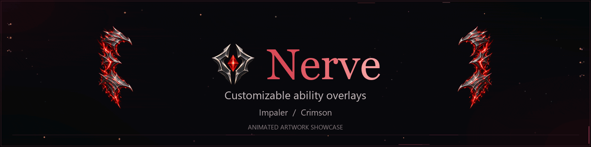
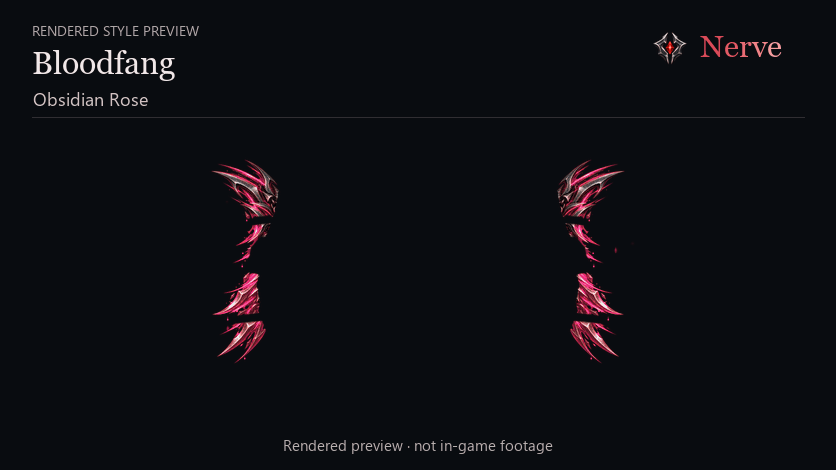
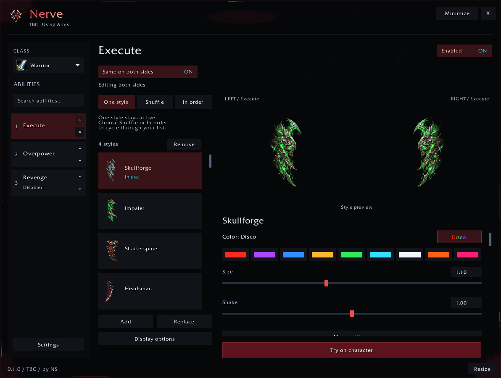

Nerve adds customizable ability overlays to **WoW Forever**. Choose your styles and colors, then adjust the look directly on your character.

**[Download on CurseForge](https://www.curseforge.com/wow/addons/nerve)** · [Style gallery](docs/style-gallery.md) · [Setup guide](docs/getting-started.md) · [Report a problem](https://github.com/eggntoast/Nerve-Public/issues/new/choose) · [Changelog](CHANGELOG.md)

Currently supports **Warrior: Execute, Overpower, Revenge and Victory Rush**.

## See the styles

*Bloodfang in Obsidian Rose and Impaler in Crimson. Rendered preview, not in-game footage.*

[Explore all twelve styles and more colors →](docs/style-gallery.md)

## Make it yours

* **12 styles, 9 colors and Disco.** Build a collection for each ability. Disco picks a new color when an overlay becomes active.
* **One style, Shuffle or In order.** Keep a favorite or cycle through your collection.
* **Independent sides.** Match the left and right overlays or customize each separately.
* **Try it on your character.** Adjust size, position, shake and appearance before returning to play.

*Settings shown in the older TBC version. New updates are for WoW Forever only; the TBC version is no longer maintained.*

Open **/nerve** or click the minimap icon to get started. The [setup guide](docs/getting-started.md) covers installation, previews and saving your setup.

## Download

**Startup issue after the latest Forever update:** Nerve 0.1.2 can fail to open because the game no longer supplies a realm name. A correction is being tested. Keep your saved settings; there is no need to delete them.

[**Nerve Forever 0.1.2**](https://www.curseforge.com/wow/addons/nerve/files/9617329) is the latest release. Your settings are kept for each character.

GitHub’s **Code → Download ZIP** contains this gallery and its help pages, not an installable addon.

See [downloads and current support](docs/downloads.md) for details.

## Class support

Nerve is being built for all nine classes in WoW Forever, one class at a time. Currently, only **Warrior** is supported.

Display priority chooses which overlay appears. Nerve isn’t a rotation guide.

## Help and updates

[Get help](docs/help.md) · [Report a problem](https://github.com/eggntoast/Nerve-Public/issues/new/choose) · [Read the changelog](CHANGELOG.md)

This repository is Nerve’s public gallery and help hub. Download the addon from [CurseForge](https://www.curseforge.com/wow/addons/nerve).

Made by **NS**. Code and documentation use the [MIT license](LICENSE). Artwork and branding have [separate terms](ASSET_LICENSE.md).
