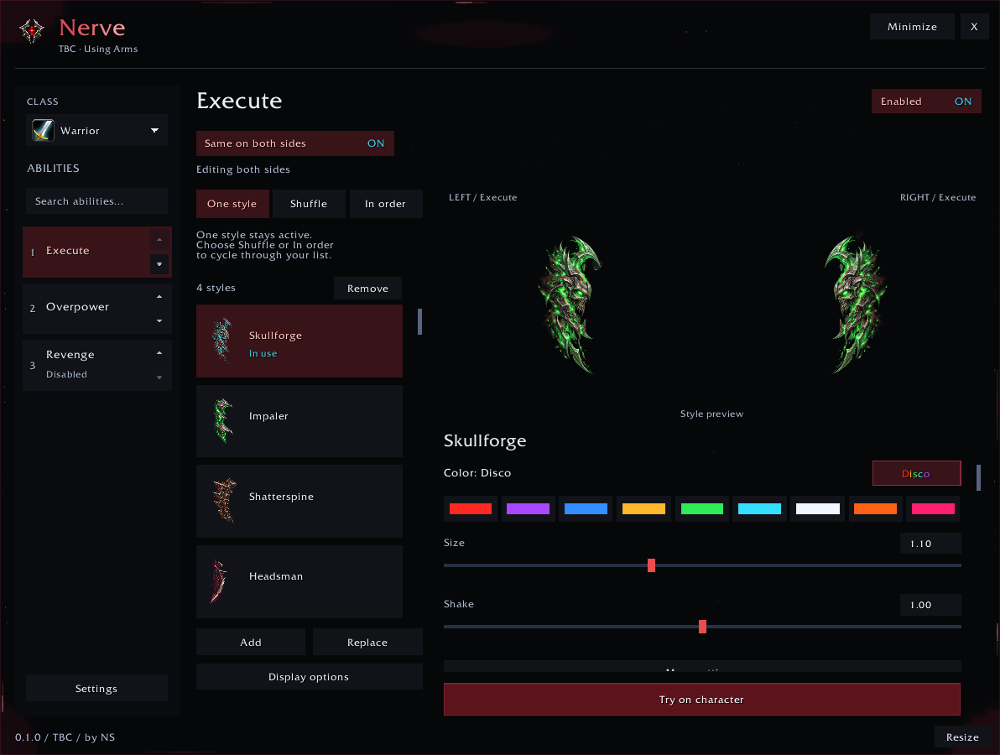

# Getting started

Download the latest [Nerve Forever release](downloads.md). New updates are for WoW Forever only.

## Install Nerve

1. Extract the ZIP’s **Nerve** folder into your client’s `Interface/AddOns` folder.
2. Enable Nerve in the game’s addon list.
3. Open **/nerve** or click the minimap icon.

GitHub’s **Code → Download ZIP** is not the addon package. Use the [CurseForge download](https://www.curseforge.com/wow/addons/nerve).

## Choose your look

1. Select an ability and choose a style.
2. Pick a color, or use **Disco** to choose a new color when the overlay becomes active.
3. Choose **One style**, **Shuffle** or **In order** for your collection.
4. Select **Try on character** to adjust size, position, shake and appearance.
5. Use **Stop preview** when finished. Entering combat also ends the preview.

*Settings shown in the older TBC version, which is no longer maintained.*

**Same on both sides** keeps the left and right overlays together. Turn it off to edit each side separately.

## Fade and combat visibility

Select **Victory Rush** and open **Display options** to find **Fade with remaining time**. It is on by default. The overlay fades with the remaining buff time when that timing is available; otherwise, it stays steady. Turn the option off if you prefer a steady overlay.

The overlay stays hidden while Victory Rush is on its own cooldown, even if you have a fresh Victorious buff. When it can appear again, the fade keeps the buff’s original expiration.

**Settings → Behavior → Only in combat** hides overlays outside combat, even while an ability remains available. It is off for new installations; updating preserves your existing choice.

## Keep your setup

When updating from an older version, Nerve may ask which settings to use. Choose your existing character's settings and click **Use these settings**. This is a one-time choice; your settings and backups are kept.

**Backups** holds saved setups and copying from another compatible character. Reset controls are under **Settings → Reset**; check what will be reset before confirming.

Your settings are kept separately for each character.

**Window effects** controls decoration in the settings windows. Turning it off leaves the ability effects running.

[Browse the styles](style-gallery.md) · [Get help](help.md) · [Back to Nerve](../README.md)
